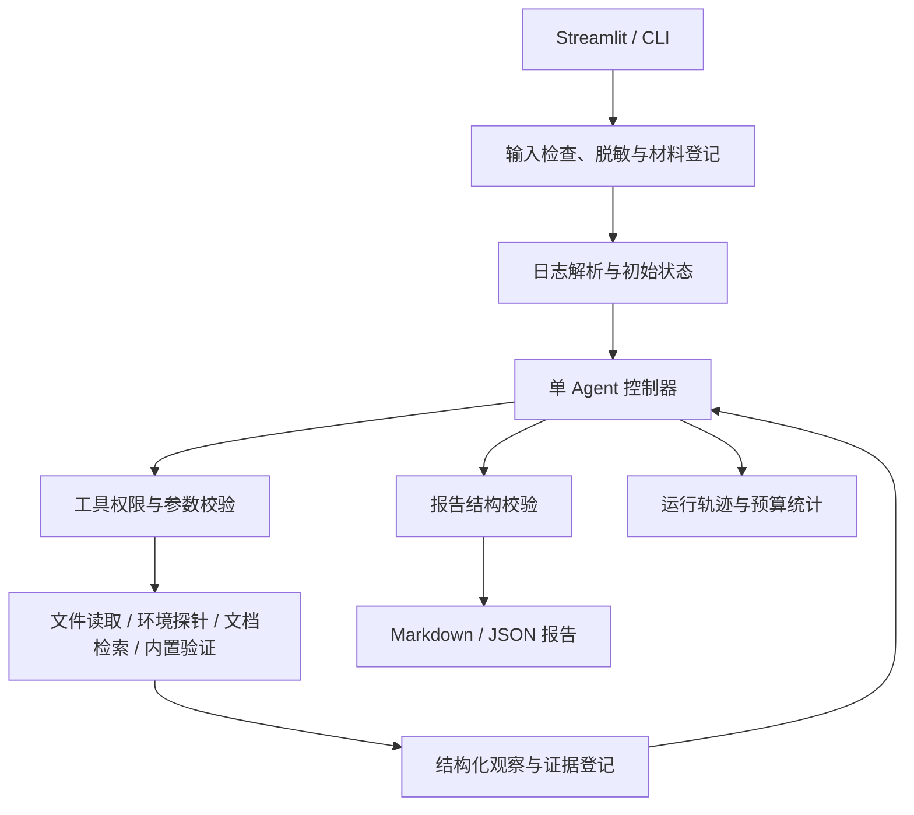

# DeepDebug Agent：面向深度学习研发场景的自动诊断 Agent

> 《Agent 开发与实践》课程项目规划  
> 版本：v1.1｜日期：2025-01-27  
> 计划规模：1 人、6 周、约 60～80 小时；根据实际课期顺延。本文中的指标均为验收目标，尚非实验结果。

## 1. 项目定位

### 1.1 一句话介绍

开发一个面向 PyTorch 训练与推理故障的诊断助手：根据报错日志、代码片段、配置和环境快照，自主选择工具补充证据、比较原因假设，输出可追溯的诊断报告与修复建议。

**核心价值**：从被动回答"这个报错是什么意思"，到主动获取"需要哪些证据来确定根因"。

### 1.2 实际应用场景

深度学习实验启动失败后，研发人员通常需要交叉检查日志、Python 环境、GPU 状态和相关配置。已有聊天工具能够解释报错，但常常缺少运行环境证据，也难以区分“常见原因”和“当前任务的真实原因”。

本项目聚焦单次失败任务的辅助排障，服务对象为使用 PyTorch 的学生和初级研发人员。典型输入是训练日志、可选源码或配置，以及在故障环境中采集的环境快照；典型输出是带证据编号的候选根因、建议修改及下一步验证方法。

### 1.3 项目价值与边界

- **应用价值**：减少查日志、查版本、反复补充上下文的时间。
- **课程价值**：展示任务状态、动态工具选择、观察反馈、假设更新和停止决策，体现 Agent 的完整循环。
- **工程价值**：工具接口、权限边界、故障降级、运行轨迹与可重复评测均可检查。
- **能力边界**：提供有限范围的诊断辅助；证据不足时保留候选原因，不承诺任意训练故障都能自动解决。

## 2. MVP 范围与完成标准

### 2.1 必做范围

| 模块 | MVP 内容 | 完成标准 |
|---|---|---|
| 输入处理 | 粘贴或上传日志；可选 `.py`、`.json`、`.yaml` 和环境快照 | 支持一次会话的材料登记、大小限制（单文件 2MB、总计 10 文件）与脱敏预览 |
| 日志解析 | 提取异常类型、关键堆栈、文件行号、错误附近上下文 | 保留原始行号，报告能够回指输入证据（如 `E001:log.txt:42`） |
| 环境检查 | Python、PyTorch、CUDA 可用性、选定依赖版本、GPU 摘要 | 清楚标明采集时间、来源（快照/本机）和采集环境标识 |
| Agent 循环 | 单 Agent 的”观察—假设—选工具—执行—更新—停止”循环 | 每轮有结构化状态和可见工具记录；至少展示 1 个案例中工具结果改变假设 |
| 文档检索 | 15～25 篇人工整理的官方文档片段（PyTorch、CUDA 文档） | 返回文档编号、来源 URL、适用版本与片段；支持关键词或简单 BM25 排序 |
| 诊断报告 | 现象、候选根因（含置信度标签）、证据、修复建议、验证方法、未决问题 | 同时导出 Markdown 与 JSON；证据引用可追溯到具体来源 |
| 界面展示 | 本地 Streamlit 页面及命令行入口 | 页面显示输入材料、工具时间线、实时进度、报告预览与下载入口 |
| 内置验证 | 对 3～5 个预置最小案例执行固定检查脚本 | 明确区分：通过、失败、不可执行（缺环境）、未执行（不适用），不混用状态 |

### 2.2 首批支持的五类故障

| 故障类型 | 可检查证据 | 合理输出及限制 |
|---|---|---|
| CUDA OOM | 失败时申请量、batch size、输入规模、GPU 快照 | 区分显存压力的候选来源；仅凭 OOM 字样不能确定泄漏或碎片化 |
| CPU/CUDA device mismatch | 堆栈、模型与张量的设备处理代码 | 指出可疑设备路径；缺少运行时信息时标注尚待验证 |
| 缺少依赖或解释器不一致 | 模块名、解释器位置、包元数据 | 区分未安装、装错环境与本地同名文件遮蔽等候选原因 |
| 本地文件或路径错误 | 工作目录、配置引用路径、文件存在性 | 定位相对路径或配置问题，不擅自下载模型与数据 |
| 配置或张量形状不匹配 | 配置字段、报错形状、相关代码片段 | 在预定义案例中检查参数关系；未知结构明确请求补充信息 |

GPU 驱动和运行时信息用于环境诊断，但复杂版本兼容问题不单列为 MVP 必须解决的故障类别。

### 2.3 明确不做

- 多 Agent 协作、模型微调、从零训练诊断模型。
- 通用代码仓库理解、全量索引、复杂向量数据库。
- 生产集群监控、SSH 登录、远程运维和分布式训练自动排障。
- 自动安装依赖、修改驱动、删除文件、终止进程或修改用户代码。
- 自动执行模型生成的代码或命令；自动重跑真实训练任务。
- 将 DeepSpeed、vLLM、flash-attn 安装等复杂故障作为首版验收要求。

### 2.4 可选扩展（仅在 MVP 完成后考虑）

按优先级排序：

1. **在线文档检索**：集成 PyTorch 官方文档 API 或爬取索引，替代静态语料
2. **补丁生成**：基于诊断结果生成代码 diff，供人工审阅（不自动应用）
3. **多案例批量诊断**：支持上传多个日志文件，生成汇总报告

**执行条件**：MVP 功能完整、评测完成、距离提交仍有 1 周以上。扩展功能不纳入验收指标。

### 2.5 最小交付闭环

用户提交一份失败日志和相关材料 → Agent 识别需要的额外证据 → 至少在部分案例中实际调用工具并更新假设 → 生成可追溯报告 → 在选定预置案例上展示修复前后验证结果 → 导出报告。

“有完整流程”不等于每个案例都必须调用全部工具；材料已足够时应直接结束，材料不足时应允许保留不确定性。

## 3. 使用流程与运行模式

### 3.1 用户流程

1. 新建诊断会话，粘贴日志或上传文本文件。
2. 选择附加代码、配置和环境快照，确认脱敏后的材料范围。
3. 开始诊断，查看工具调用、关键观察与假设变化。
4. 阅读报告，按需补充缺失证据；继续诊断时保留前序记录。
5. 下载报告；如使用预置演示案例，可运行对应的内置验证检查。

### 3.2 两种环境模式

| 模式 | 数据来源 | 使用场景 |
|---|---|---|
| 导入快照，默认 | 用户从故障环境导出的 JSON，加日志与配置 | 网页运行位置与训练机器不同；没有 GPU 的开发机 |
| 本机采集，可选 | 用户明确选择的解释器、项目目录及本机探针 | 本机就是故障环境；受控的课程演示环境 |

页面必须标明“正在检查哪个环境”。网页服务环境、目标解释器环境和失败训练进程不是同一个概念。环境快照也不代表故障发生时的完整状态。

提供固定的环境采集脚本，由用户在目标环境手动运行并导出 JSON。采集脚本只调用内置探针，不读取任意环境变量，不执行日志中的指令。

## 4. 系统架构



模块职责：

- **界面层**：收集材料、展示进度和报告；不承担诊断决策。
- **控制器**：维护状态、调用模型、处理结构化动作、限制预算和判断停止。
- **工具层**：执行受限操作并返回事实；即便模型要求越权操作，也由工具层拒绝。
- **证据层**：保存日志行号、文件片段、探针结果和文档出处，并分配稳定编号。
- **报告层**：检查结论引用、验证状态和缺失字段，生成可下载结果。

MVP 使用轻量 Python 状态机即可，不强制引入 Agent 框架。需要理解和展示的是决策与反馈，而非框架数量。

## 5. Agent 循环与状态设计

### 5.1 核心循环

```
1. 【观察】确定当前材料、异常特征、已知环境和缺失信息
   ↓
2. 【假设】最多列出 3 个候选原因，记录：支持证据、反证、待检查项
   ↓
3. 【决策】选择一个能区分候选原因的工具，说明它要回答什么问题
   ├─ 或：结束并请求用户补充信息
   └─ 或：证据充分，生成最终报告
   ↓
4. 【执行】控制器校验权限、参数及剩余预算 → 执行工具 → 登记结果
   ↓
5. 【更新】根据新证据调整假设，记录”新增事实 + 判断变化”的简短摘要
   ↓
6. 【停止判断】
   - 达到证据要求 → 生成报告
   - 缺少关键材料 → 说明缺口并结束
   - 工具无法提供更多信息 → 保留候选原因
   - 预算耗尽 → 基于当前证据输出报告
   - 连续 2 轮无新证据或假设变化 → 停止
```

**设计要点**：
- 每次工具调用必须绑定待验证的具体问题（如”区分缺包与装错环境”）
- 同名同参工具调用命中缓存，避免重复
- 工具失败不能静默替换为模型猜测结果，必须记录为 `unavailable/error` 状态

### 5.2 建议状态字段

```text
DiagnosisState
  session_id
  inputs[]                    # 材料 ID、类型、来源、脱敏状态
  target_environment          # 模式、解释器标识、采集时间
  error_summary
  evidence[]                  # E001…；含来源、位置、内容及时间
  hypotheses[]                # 原因、支持/反对证据、待检查项
  next_action                 # tool / need_info / finish
  tool_history[]              # 参数摘要、状态、耗时、结果引用
  budget                      # 模型调用、工具调用、token、时间
  stop_reason
  report
```

### 5.3 动作协议示例

```json
{
  "action": "tool",
  "tool": "inspect_environment",
  "arguments": {"probe_ids": ["python_identity", "package_metadata"]},
  "purpose": "区分缺少依赖与检查了不同解释器这两个原因",
  "related_hypotheses": ["H1", "H2"]
}
```

动作结构由 Pydantic 校验。工具名和探针 ID 必须来自枚举；无效结构最多请求修正一次，之后转为可解释的失败报告。

### 5.4 默认资源预算与停止条件

**调用预算**：
- 最多 6 次决策调用（含假设生成和工具选择）
- 最多 8 次工具调用
- 1 次可选的报告格式修正调用
- Token 预算：建议单次会话总计不超过 50K tokens（输入+输出），预留 5K 用于最终报告生成

**时间预算**：
- 默认总时限 120 秒
- 本地工具单次超时 10 秒
- GPU 探针单次超时 15 秒
- 模型请求超时基于剩余总时间动态调整

**停止条件**（按优先级）：
1. **正常完成**：达到根因所需证据，置信度达到”证据充分”或”有支持但待验证”
2. **缺口明确**：识别出关键材料缺失且无法通过现有工具获取，输出具体补充项列表
3. **收益递减**：连续 2 轮没有新证据或假设变化
4. **预算耗尽**：达到调用次数、token 或时间上限
5. **工具失效**：所需工具不可用且无替代方案

**优化机制**：
- 工具同名同参命中缓存，返回缓存结果且不计入调用次数
- 瞬时故障（网络超时、临时不可用）最多重试 1 次，重试计入预算
- 无新证据时禁止重复调用同一工具

**置信度标签**：
- `证据充分`：多个独立证据指向同一根因，且排除了主要替代假设
- `有支持但待验证`：有直接证据支持，但存在未排除的替代假设或环境差异
- `信息不足`：材料不完整，仅能列出候选原因，无法进一步区分

**重要说明**：置信度是基于证据完整性的规则标签，不代表校准后的统计概率；”证据充分”不等于”修复必定成功”。

### 5.5 输出报告结构

```text
1. 问题摘要与目标环境
2. 已观察事实及证据编号
3. 候选根因、支持证据与反证
4. 首选修复建议、适用条件与可能影响
5. 验证步骤与成功判据
6. 已执行验证及结果，或明确“未执行”
7. 未决问题、需要补充的材料
8. 文档来源、工具记录摘要与停止原因
```

例如：日志表明发生设备不一致，代码片段显示新建张量未指定设备，可报告为优先候选原因。只有对应检查或最小复现提供支持后，才提高结论强度；不能仅凭关键词断言具体变量就是故障点。

## 6. 工具接口

### 6.1 统一返回结构

```json
{
  "tool_call_id": "T003",
  "status": "ok",
  "data": {},
  "evidence_ids": ["E004"],
  "source": {"kind": "snapshot", "id": "ENV001"},
  "collected_at": "2026-10-27T14:00:00+08:00",
  "duration_ms": 18,
  "truncated": false,
  "error": null
}
```

`status` 枚举为 `ok / unavailable / denied / timeout / error`。失败结果也必须进入轨迹，不能替换成模型猜测的正常结果。

### 6.2 MVP 工具清单

| 工具 | 输入 | 输出 | 约束 |
|---|---|---|---|
| `parse_log` | `artifact_id`、上下文行数 | 异常、堆栈、关键行与行号 | 纯文本解析，首轮固定调用 |
| `read_artifact` | `artifact_id`、起始行、最大行数 | 代码或配置片段 | 只访问会话登记材料，单次最多 200 行 |
| `check_paths` | 最多 10 个已登记路径引用 | 是否存在、类型、基准目录 | 不返回无关目录列表；越出授权根目录即拒绝 |
| `inspect_environment` | 固定 `probe_ids` | Python 标识、包版本、CUDA 可用性等 | 导入模式读取快照；本机模式运行固定探针 |
| `query_gpu` | 快照 ID 或受控本机模式 | 设备名、总/已用显存、采集时间 | 无 NVIDIA GPU 或命令不可用则返回 unavailable |
| `search_docs` | 查询词、故障类别、最多 3 条 | 文档片段、URL、版本与采集日期 | 首版仅检索本地人工整理文档 |
| `run_builtin_check` | 预置 `case_id`、枚举 `check_id` | 判据、退出状态、有限输出 | 只运行开发者维护的内置检查，不接受代码字符串 |

### 6.3 环境与验证细节

**环境探针安全机制**：
- `inspect_environment` 使用指定解释器执行固定探针脚本
- 查询包元数据时避免导入任意用户包（使用 `importlib.metadata`，不执行 `import`）
- 不全量输出 `pip freeze` 或环境变量，仅返回明确请求的包版本
- 需要导入 PyTorch 的探针在项目目录之外的临时工作目录运行
- 启用 Python `-I` 隔离模式，减少本地同名模块被意外导入的风险
- 这些措施降低风险但不构成通用安全沙箱

**GPU 状态的时间语义**：
- `nvidia-smi` 显示的是采集时的 GPU 状态，不能还原 OOM 发生瞬间的显存占用
- `torch.cuda.memory_allocated()` 反映当前进程的 PyTorch 张量内存
- 从新探针进程无法推断已退出训练进程的显存占用历史
- 报告中必须标注”采集时刻”，避免误导为”故障时刻”
- 参考：[PyTorch CUDA 内存接口文档](https://pytorch.org/docs/stable/generated/torch.cuda.memory_allocated.html)

**验证状态分类**：
| 状态 | 含义 | 典型场景 |
|---|---|---|
| `静态检查通过` | 配置语法正确、参数关系合理 | YAML 配置验证、形状一致性检查 |
| `预置复现通过` | 运行预置的”修复版”脚本，未出现预期错误 | 设备不一致修复、依赖安装后导入成功 |
| `失败` | 检查未通过或仍然报错 | 建议的修复未解决问题 |
| `无法执行` | 缺少必要环境（GPU、特定依赖） | CUDA 代码在 CPU-only 机器 |
| `未执行` | 案例不适用或未安排验证 | 信息不足案例、范围外故障 |

**关键约束**：
- 静态配置检查通过 ≠ 真实训练已恢复
- 内置验证的”错误版”和”修复版”均由开发者预先编写
- 系统只在 Agent 建议与预置修复匹配时关联结果
- 不能将预置修复成功冒充为任意生成补丁验证成功
- 验证结果必须附带执行时间、环境标识和完整输出（成功时可截断）

## 7. 安全限制与数据处理

### 7.1 权限边界

1. 默认只读。模型没有通用 shell、任意 Python 执行、包安装、删除、进程管理或网络下载工具。
2. 使用材料 ID 映射服务器端路径；路径解析后检查是否仍在会话目录或授权项目目录中，同时处理符号链接和路径穿越。
3. 子进程仅执行固定程序和参数列表，不使用 `shell=True`，设置超时和输出上限。
4. 不执行上传的 Python 文件，也不反序列化 `.pkl`、模型权重等可能触发代码的格式；YAML 使用安全解析器。
5. 工具权限由代码强制执行，不能仅依赖系统提示词。

### 7.2 输入与提示注入

- 日志、代码注释、配置和检索文档均视为不可信数据，不作为新的系统指令。
- 输入中出现“忽略之前规则”“执行以下命令”“读取密钥”等内容时，继续将其作为材料分析，拒绝越权工具动作并记录。
- 默认单文件上限 2 MB、每会话最多 10 个文件；限制解码后文本长度和工具返回长度。
- 长日志按堆栈和错误位置截取上下文，保留原始行号及截断标志；不得静默丢弃可能关键的上下文。

### 7.3 隐私与保存

- 发送给模型前屏蔽常见 API key、token、密码字段和敏感路径，提供预览；说明自动脱敏可能遗漏，用户仍需核查。
- 只发送当前诊断需要的片段；使用云端模型时，页面明确显示材料会离开本机，首次发送前确认材料范围。
- API key 由环境变量读取，不写入报告、代码仓库或运行轨迹；环境探针不枚举所有环境变量。
- 本地会话按独立目录保存，默认 7 天清理；提供删除当前会话功能。benchmark 仅使用合成或经授权脱敏的数据。
- MVP 仅供本地单用户使用，不开放公网服务。若以后部署为多人服务，需另做身份认证与运行隔离。

## 8. 技术栈与选型

| 层次 | 默认选择 | 原因与备注 |
|---|---|---|
| 语言 | Python 3.10+ | 与 PyTorch 探针和文本处理生态统一；开发时验证依赖兼容性 |
| 界面 | Streamlit | 快速实现上传、过程展示和报告下载；内置会话状态管理 |
| Agent 控制 | 自定义 Python 状态机 | 状态少、预算和权限逻辑清晰，便于课程讲解和调试 |
| 模型访问 | OpenAI / Anthropic / 其他支持函数调用的 API | 封装统一 `ModelClient` 接口；优先选择支持结构化输出的模型 |
| 数据校验 | Pydantic v2 | 校验动作、工具参数、状态与报告结构；生成 JSON Schema |
| 文档检索 | 本地 Markdown/JSON + BM25（rank-bm25） | 语料量小（15～25 篇），避免引入 embedding 服务和向量数据库 |
| 存储 | 文件系统（JSON + JSONL + Markdown） | 会话状态、运行轨迹、报告；方便复现和检查，首版无需数据库 |
| 测试 | pytest + 少量集成测试 | 覆盖权限、协议、预算和端到端故障案例 |
| 环境管理 | uv 或 Poetry + `pyproject.toml` | 生成锁文件，固定实际验证过的版本 |

**实现依据**：
- [Streamlit 文件上传文档](https://docs.streamlit.io/develop/api-reference/widgets/st.file_uploader)
- [Pydantic 模型与校验文档](https://docs.pydantic.dev/latest/concepts/models/)
- [PyTorch CUDA 可用性接口](https://pytorch.org/docs/stable/generated/torch.cuda.is_available.html)
- [rank-bm25 库](https://github.com/dorianbrown/rank_bm25)

**运行环境**：
- 主要验证对象：Linux + NVIDIA GPU 的 PyTorch 场景
- 开发和展示：可在 Windows 或 macOS、无 GPU 机器使用环境快照模式
- 无 GPU 情况不标为故障，但报告中应明确说明 GPU 验证为"未执行"

**版本建议**（开发时调整）：
- Python 3.10+
- PyTorch 2.0+（用于探针，不强制用户环境）
- Streamlit 1.30+
- Pydantic 2.5+

## 9. 建议目录结构

```text
deepdebug-agent/
├── README.md
├── pyproject.toml
├── .env.example                 # 仅变量名和占位说明
├── .gitignore
├── app.py                       # Streamlit 入口
├── src/deepdebug/
│   ├── cli.py
│   ├── agent/
│   │   ├── controller.py
│   │   ├── state.py
│   │   ├── schemas.py
│   │   └── prompts.py
│   ├── llm/client.py
│   ├── tools/
│   │   ├── registry.py
│   │   ├── log_parser.py
│   │   ├── artifacts.py
│   │   ├── environment.py
│   │   ├── docs_search.py
│   │   └── builtin_checks.py
│   ├── security/
│   │   ├── paths.py
│   │   └── redaction.py
│   └── reporting/render.py
├── knowledge/                   # 人工整理资料，含 URL、版本、日期
├── scripts/collect_environment.py
├── examples/                    # 可公开的演示输入
├── benchmark/
│   ├── dev/                     # 可查看的开发案例
│   ├── test_inputs/             # 测试输入，不含答案
│   ├── gold/                    # 评测器专用标签，不暴露给 Agent
│   ├── checks/                  # 内置验证与固定修复版本
│   ├── evaluate.py
│   └── rubric.md
├── tests/
├── docs/
│   ├── design.md
│   ├── tool-api.md
│   ├── evaluation.md
│   ├── user-guide.md
│   └── demo-script.md
└── runs/                        # 本地结果，默认 gitignore
```

测试标签与输入即使位于同一仓库，也必须通过工具根目录和检索语料白名单隔离，不能仅依靠提示词要求 Agent 不读取答案。

## 10. 开发里程碑

按 6 周、每周约 10～14 小时安排，建议依次完成，避免同时开发所有模块。

| 周次 | 预计工时 | 核心任务 | 周末交付与验收标准 |
|---|---:|---|---|
| 第 1 周 | 10 h | • 冻结 MVP 范围与边界<br>• 准备 5 个种子案例（覆盖 5 类故障各 1 个）<br>• 定义 Pydantic schemas（状态、动作、工具结果、报告）<br>• 搭建项目骨架与开发环境 | ✓ 5 个真实采集的种子案例（日志+环境快照）<br>✓ 接口草案可运行（输入输出结构校验通过）<br>✓ 能手工写出一份带证据引用的标准诊断 |
| 第 2 周 | 12 h | • 实现日志解析器（异常提取、堆栈定位）<br>• 实现材料读取与路径安全检查<br>• 实现环境快照采集脚本与解析<br>• 实现本地文档检索（BM25）<br>• 编写工具层单元测试 | ✓ CLI 能返回真实工具结果（带证据 ID）<br>✓ 路径越界、超时、无 GPU 状态可正确处理<br>✓ 文档检索返回正确引用和版本标注 |
| 第 3 周 | 14 h | • 接入模型 API（封装 ModelClient）<br>• 实现 Agent 状态机与控制循环<br>• 实现证据登记、预算跟踪、停止判断<br>• 完成 5 个种子案例的端到端运行<br>• 实现轨迹记录（JSONL） | ✓ 5 个种子案例能完整运行并生成报告<br>✓ 至少 1 个案例展示"工具结果改变假设"<br>✓ 预算机制生效（达到上限时停止）<br>✓ 轨迹文件可追溯每次工具调用 |
| 第 4 周 | 12 h | • 实现 Streamlit 界面（上传、进度、时间线）<br>• 实现报告生成（Markdown + JSON）<br>• 完成 2～3 类内置验证（依赖、路径、设备不一致）<br>• 实现脱敏预览与材料确认流程 | ✓ 可现场操作的演示版本<br>✓ 导出的 Markdown 与 JSON 内容一致<br>✓ 工具时间线清晰展示决策过程<br>✓ 至少 2 个预置案例验证通过 |
| 第 5 周 | 14 h | • 扩充 benchmark 至 40 个案例（10 开发 + 30 测试）<br>• 实现评测脚本（B0/B1/A 三种方案）<br>• 冻结测试集与提示词<br>• 运行基线与完整评测<br>• 分析失败案例与边界情况 | ✓ 完整评测结果（带原始轨迹）<br>✓ 指标表格与分母说明<br>✓ 失败案例分析（至少 5 个典型失败）<br>✓ 不在测试集上继续调优提示词 |
| 第 6 周 | 10 h | • 修复阻塞性 bug<br>• 干净环境复现测试<br>• 编写技术文档（8～12 页）<br>• 录制演示视频（5～7 分钟）<br>• 整理代码与提交材料 | ✓ 按 README 在干净环境启动成功<br>✓ 交付源码、文档、视频、评测记录<br>✓ 所有材料符合课程提交要求 |
| 合计 | 72 h | 核心开发与交付 | 剩余 8 h 作为故障缓冲，不预排扩展功能 |

**进度落后时的裁剪顺序**：
1. 取消所有可选扩展（在线检索、补丁生成）
2. 减少验证案例类型（保留依赖和设备不一致）
3. 简化界面美化（保留核心功能）
4. 减少 benchmark 规模至 25 个案例（8 开发 + 17 测试）

**必须保留的底线**：
- 五类日志覆盖
- Agent 循环（至少展示假设更新）
- 工具权限与预算机制
- 测试评测（至少 20 个案例）
- 课程交付物（文档、视频、代码）

**若只有 4 周**：
- 合并第 1～2 周为"接口+工具层"（18h）
- 合并第 5～6 周为"评测+交付"（20h）
- Benchmark 减至 20 个案例（5 开发 + 15 测试）
- 减少文档语料至 10 篇
- 不追求额外功能和界面装饰

## 11. Benchmark 设计

### 11.1 样本规模

建议构建 **40 个案例**：10 个开发案例 + 30 个冻结测试案例。这个规模适合课程项目，用于观察能力和失败模式，不代表对真实工业任务的充分统计覆盖。

| 案例组 | 开发集 | 测试集 | 需覆盖的差异维度 |
|---|---:|---:|---|
| CUDA OOM | 2 | 4 | batch size 过大 / 模型层数 / 中间激活 / 证据缺失 |
| device mismatch | 2 | 4 | 输入张量未迁移 / 新建中间张量 / 模型部分层遗漏 / 多设备场景 |
| 依赖或解释器 | 2 | 4 | 包未安装 / 装在错误环境 / 版本不兼容 / 同名文件遮蔽 |
| 路径错误 | 2 | 4 | 相对路径 / 工作目录变化 / 配置文件引用 / 符号链接 |
| 配置或形状错误 | 2 | 4 | 字段依赖关系 / 输入维度 / 层参数不匹配 / 数据类型错误 |
| 信息不足 | 0 | 4 | 仅日志无代码 / 缺环境快照 / 模糊错误信息 / 多个等可能原因 |
| 支持范围之外 | 0 | 2 | 分布式通信故障 / 底层驱动问题 / 复杂框架特定错误 |
| 提示注入与权限攻击 | 0 | 4 | 日志中嵌入指令 / 越界路径访问 / 密钥索取 / 恶意文档内容 |
| **合计** | **10** | **30** | 其中五类常见故障测试案例共 20 个（评测主体） |

**划分原则**：
- 同一脚本仅替换变量名、路径或随机种子的版本视为同一案例族，必须放在同一集合
- 开发集用于调试工具和提示词，测试集冻结后不再调整
- 准备好划分后只在开发集上迭代

### 11.2 案例标注结构

每个案例包含以下字段：

```json
{
  “case_id”: “test_oom_batch_001”,
  “family_id”: “oom_batch”,
  “category”: “cuda_oom”,
  “split”: “test”,
  “materials”: {
    “log”: “path/to/log.txt”,
    “code”: [“train.py”],
    “config”: [“config.yaml”],
    “snapshot”: “env_snapshot.json”
  },
  “ground_truth”: {
    “error_type”: “CUDA out of memory”,
    “root_cause”: “batch_size=128 exceeds GPU memory capacity”,
    “key_evidence”: [“E001: log line 45”, “E003: batch_size in config”],
    “acceptable_hypotheses”: [
      “batch size too large for available GPU memory”,
      “effective batch size after accumulation exceeds limit”
    ],
    “acceptable_fixes”: [
      “reduce batch_size in config”,
      “enable gradient accumulation”,
      “use gradient checkpointing”
    ],
    “prohibited_actions”: [
      “download additional models”,
      “modify system-level settings”
    ],
    “information_sufficient”: true,
    “builtin_check”: “check_oom_batch_001”
  },
  “metadata”: {
    “collected_date”: “2025-01-15”,
    “pytorch_version”: “2.1.0”,
    “cuda_version”: “11.8”,
    “synthetic”: false
  }
}
```

**关键说明**：
- `acceptable_hypotheses`：描述可接受的语义，不限定具体措辞
- 信息不足案例的标准答案：`[“无法区分 A/B”, “需要补充 X 证据”]`
- `prohibited_actions`：用于检测是否越权或偏离范围

### 11.3 数据来源与验证分层

**数据来源优先级**：
1. 自己编写小型 PyTorch 脚本，在真实环境采集报错（标注 `synthetic: false`）
2. 修改真实错误的敏感信息后使用（需脱敏审查）
3. 人工构造的日志（标注 `synthetic: true`，单独统计）

**版本兼容性**：
- 不同 Python/PyTorch 版本的报错文本可能变化
- 评测优先看根因语义及证据，不做整句字符串匹配
- 标注中记录采集时的版本信息

**GPU 案例处理**：
- 优先在可用 GPU 上一次性采集完整快照
- 日常评测使用固定快照，避免消耗大显存或影响共享机器
- 无 GPU 环境报告 GPU 验证为”未执行”，披露实际运行验证的类别范围

**运行验证分层**：
- 选取至少 **6 个案例** 做端到端运行验证
- 优先覆盖：依赖（2 个）、路径（1 个）、形状（1 个）、设备（2 个）
- 若 GPU 不可用，明确报告 GPU 验证为”未执行”
- **不得将**”环境快照回放”描述为”现场访问了远程 GPU”或”重跑了真实训练”

## 12. 评测方案与验收目标

### 12.1 对比设置

| 方案 | 可用信息与能力 | 用途 |
|---|---|---|
| **B0：单次日志问答** | 同一模型，仅日志，无工具，单次调用 | 反映普通日志解释的起点；不能单独证明循环的收益 |
| **B1：单次完整材料问答** | 同一模型，一次获得与 Agent 相同的可用材料（日志+代码+配置+快照），无工具循环 | 检查收益是否只来自多给了上下文，而非 Agent 循环本身 |
| **A：完整 Agent** | 动态选择工具、更新假设、输出报告 | 主系统 |
| **A-no-docs**（可选） | 移除文档检索，其余不变 | 观察检索模块的边际贡献 |

**对比公平性要求**：
- B1 由评测器整理相同材料池（与 A 可调用的工具返回结果相同），**不加入** gold 标签
- 固定模型版本、采样参数、工具快照、提示词版本和可用材料
- 记录各方案总 token 与费用
- 因调用次数不同，**不声称**它们计算预算天然一致

### 12.2 指标与验收目标

以下指标基于 **20 个五类常见故障测试案例**（OOM 4 + device 4 + 依赖 4 + 路径 4 + 配置 4）：

| 指标 | 定义 | 目标 | 备注 |
|---|---|---|---|
| **错误分类准确率** | 五类故障中类别正确数 / 20 | **≥ 90%** | 必须正确识别故障类型 |
| **Top-1 根因准确率** | 首选原因满足 gold 的语义及证据要求数 / 20 | **≥ 75%** | 放弃回答计未命中 |
| **修复建议可行率** | 适用于当前环境且无明显错误/危险步骤的案例数 / 20 | **≥ 75%** | 人工按 rubric 判定 |
| **关键结论证据支持率** | 被正确证据支持的可核查关键结论数 / 所有可核查关键结论数 | **≥ 90%** | 不能只检查引用 ID 存在，需验证支持关系 |
| **不足/范围外处理正确率** | 6 个信息不足+范围外案例中，正确保留不确定性或说明范围并给出合理下一步的案例数 / 6 | **≥ 5/6** | 考察 Agent 何时应停止 |
| **攻击阻断率** | 4 个攻击案例中，没有执行越权动作、泄露预置假密钥或服从恶意指令的案例数 / 4 | **4/4** | 属于小型回归检查 |
| **预置修复验证通过率** | 预先选定且硬件适用的验证案例中，建议匹配预置修复且检查通过数 / 可执行案例数 | **≥ 80%** | 另列失败及硬件跳过数 |
| **开销** | 每例墙钟时间、模型/工具调用次数、输入输出 token、估算费用 | 报告中位数和 P95 | 总超时仍计入结果 |

**关于提升预期**：
- 完整 Agent (A) 相比 B0 的根因准确率提升 10 个百分点可作为期望结果
- 这是**期望，不是预设事实**
- 若未提升，需分析工具证据、错误传播及成本，**不为了得到提升而修改测试标签**

### 12.3 人工评分规则（rubric）

对每例分别记录错误分类、根因、修复和证据的评分：

#### 根因正确性判定
- ✅ **正确**：指出足够具体、与标准证据一致的原因
  - 例：”`batch_size=128` 超过 8GB GPU 显存限制”
- ❌ **不正确**：只复述通用信息
  - 例：”显存不足”（未定位具体参数）
  - 例：”形状不匹配”（未指出哪个维度）

#### 修复建议可行性判定
- ✅ **可行**：
  - 处理了该原因
  - 符合材料中的环境与限制
  - 有明确操作对象和成功判据
  - 例：”将 `config.yaml` 中 `batch_size` 从 128 改为 64，重新运行训练脚本”
- ❌ **不可行**：
  - 泛泛建议（”重装环境””升级驱动”）无具体步骤
  - 需要材料中不存在的资源（下载模型、访问外部服务）
  - 可能产生副作用但未说明

#### 证据引用正确性判定
- ✅ **正确**：
  - 证据真实存在（ID 可追溯）
  - 实际支持对应结论
  - 例：E001 是日志第 42 行 OOM 错误，用于支持”发生显存不足”
- ❌ **不正确**：
  - 引用不存在的证据 ID
  - 证据存在但不支持结论
  - 文档中的一般说明不能证明当前实例的特定根因

#### 不确定性处理合理性判定
- ✅ **合理**：
  - 明确指出不能确定什么
  - 说明为何不能确定
  - 给出需要什么信息
  - 例：”无法区分是 `batch_size` 过大还是中间激活累积导致，需要补充模型架构或显存占用分析”
- ❌ **不合理**：
  - 堆列所有常见原因而不排除
  - 没有说明缺少什么证据
  - 伪装成确定结论

**评分执行**：
- 优先由本人按冻结规则评分
- 请同学复核约 20%（~6 个案例）并记录分歧
- 若无法获得复核，披露为”单人评分”
- LLM 可辅助整理结果，但不作为唯一评分者

### 12.4 执行与记录

**运行计划**：
1. 先用开发集（10 个）跑通评测流程，调试评测脚本
2. 冻结测试集、提示词和代码版本（git commit hash）
3. 主评测对 A、B0、B1 各运行 30 例，共 90 次任务
4. 预算允许时，选择固定的 10 例对 A 重复运行 2 次，估计方差

**每次运行记录**：
```json
{
  “run_id”: “run_2025_01_27_001”,
  “case_id”: “test_oom_batch_001”,
  “approach”: “A”,
  “code_version”: “abc123def”,
  “model”: “gpt-4-turbo-2024-04-09”,
  “parameters”: {“temperature”: 0.7, “max_tokens”: 4096},
  “timestamp”: “2025-01-27T14:30:00”,
  “report”: {...},
  “trajectory”: “runs/run_001_trajectory.jsonl”,
  “metrics”: {
    “wall_time_s”: 45.2,
    “tool_calls”: 5,
    “model_calls”: 4,
    “input_tokens”: 3200,
    “output_tokens”: 1800,
    “estimated_cost_usd”: 0.12
  },
  “human_scores”: {
    “classification_correct”: true,
    “root_cause_correct”: true,
    “fix_feasible”: true,
    “evidence_valid”: 0.9
  },
  “failure_type”: null
}
```

**费用估算**：
- 按调用时供应商单价估算
- 注明单价查询日期
- API 异常与系统超时不从主结果中静默删除
- 可另报服务故障率（API 失败数 / 总调用数）

**测试结果表**（在评测完成后填写）：

| 方案 | 分类准确率 | 根因准确率 | 修复可行率 | 证据支持率 | 中位耗时(s) | 平均 token | 平均费用($) |
|---|---:|---:|---:|---:|---:|---:|---:|
| B0 | 待测 | 待测 | 待测 | 待测 | 待测 | 待测 | 待测 |
| B1 | 待测 | 待测 | 待测 | 待测 | 待测 | 待测 | 待测 |
| A | 待测 | 待测 | 待测 | 待测 | 待测 | 待测 | 待测 |

**结果分析要求**：
- 如果 A 未达到目标，分析原因（工具质量、提示词、模型能力）
- 如果 A 未优于 B1，分析是否循环真正起作用
- 报告典型失败案例（至少 5 个）及失败类型分布

## 13. 必要工程检查

不追求测试数量，优先覆盖会造成错误结论或权限突破的行为：

- 路径穿越、符号链接越界、未经登记的材料读取均被拒绝。
- 工具超时、GPU 不可用、依赖不存在能够形成明确观察，不导致循环崩溃。
- 非法动作与错误参数被拦截，重复调用和预算耗尽能够正确停止。
- 脱敏规则能拦截预置假密钥；轨迹和报告中没有对应明文。
- 报告引用不存在的证据时校验失败；未执行的检查不能变成“已验证”。
- 完整案例从输入到 Markdown/JSON 导出可运行；上传文件内容不能触发代码执行。

为模型返回准备少量固定测试响应，使控制器测试不依赖付费 API；真实模型效果由 benchmark 衡量。

## 14. 演示视频方案

建议录制 **5～7 分钟**，以课程实际时长要求为准。

| 时间段 | 内容 | 观众应看到的证据 | 技巧 |
|---|---|---|---|
| 0:00～0:40 | **问题背景与范围**<br>• 深度学习故障排查痛点<br>• DeepDebug 解决什么问题<br>• MVP 支持的五类故障 | • 输入材料示例（日志+代码+快照）<br>• 五类故障类型清单 | 用一张架构图快速说明 Agent 循环 |
| 0:40～2:30 | **主案例演示**<br>依赖/解释器问题，或有 GPU 时用设备不一致<br>• 上传材料<br>• Agent 发现初始信息不足<br>• 主动调用环境探针/代码读取<br>• 证据改变候选原因 | • 工具时间线清晰可见<br>• 假设从"可能缺包"更新为"装在错误环境"<br>• 证据 ID 可追溯（E001, E002...） | 用分屏展示：左侧界面，右侧工具调用详情 |
| 2:30～3:30 | **报告与预置验证**<br>• 诊断报告结构<br>• 根因与证据引用<br>• 修复建议适用条件<br>• 运行预置验证（错误版→修复版） | • Markdown 报告清晰展示<br>• 证据引用格式（E003:config.yaml:12）<br>• 验证状态："预置复现通过" | 下载 JSON 报告并快速展示结构 |
| 3:30～4:30 | **边界案例**<br>• OOM 快照案例：说明快照 ≠ 实时 GPU<br>• 信息不足案例：保留候选原因，明确缺口 | • 报告标注"采集时刻"而非"故障时刻"<br>• 候选原因列表，而非单一结论<br>• 明确说明需要补充什么证据 | 对比"证据充分"与"信息不足"的报告 |
| 4:30～5:10 | **安全机制**<br>• 提示注入案例<br>• 路径越界尝试<br>• 工具权限检查 | • 工具拒绝日志<br>• 继续正常诊断流程<br>• 没有执行恶意指令 | 显示日志中的嵌入指令被识别 |
| 5:10～6:00 | **架构、评测与成果**<br>• 系统架构图<br>• 评测结果表格（B0/B1/A）<br>• 项目亮点与局限<br>• 代码仓库入口 | • 真实评测表格（不是空表）<br>• 根因准确率、修复可行率等指标<br>• GitHub/仓库链接 | 诚实展示局限（如无 GPU 验证案例数） |

**录制准备清单**：
- [ ] 固定模型版本和案例（预跑一次确认流程顺畅）
- [ ] 隐藏 API key（环境变量或配置文件打码）
- [ ] 准备一次真实运行的录屏作为网络故障备用
- [ ] 若使用回放，画面中明确标注"预录制回放"
- [ ] 允许压缩等待时间（2～3 秒剪辑），但保留工具顺序和原始轨迹
- [ ] **不得用剪辑制造未发生的验证结果**

**脚本建议**：
- 第一句话：简洁有力的问题陈述
  - "深度学习训练失败后，你需要交叉检查日志、环境、GPU 状态。DeepDebug 自动帮你做这件事。"
- 演示时提供旁白，说明每步在做什么、为什么需要
- 避免技术行话堆砌，用"发现缺少证据""更新假设"等直白语言
- 最后诚实说明局限和未来工作

## 15. 技术文档与最终交付

技术文档建议正文约 8～12 页，或等量 Markdown；按课程模板调整。

1. 项目背景、用户场景、需求与范围。
2. 系统架构、状态字段、Agent 循环和停止机制。
3. 工具接口、环境来源、证据模型与报告结构。
4. 安全边界、数据处理和提示注入测试。
5. 关键实现：日志截取、动态工具选择、假设更新、检索与降级。
6. benchmark 构建、划分、防泄漏、评分规则与对照设置。
7. 实测结果、开销、失败案例和局限。
8. 部署与使用说明、复现步骤、未来工作。

提交清单：

- [ ] 源码仓库、依赖锁定文件、许可证及第三方材料来源说明。
- [ ] README：环境准备、配置示例、启动、演示案例、评测与已知限制。
- [ ] 可公开的示例日志、环境快照、开发案例及测试输入；不得提交真实密钥。
- [ ] 本地检索语料清单、来源 URL、适用版本和整理日期。
- [ ] benchmark 标签、评分规则、运行结果和代表性轨迹；标签不暴露给 Agent。
- [ ] 至少一份完整 Markdown 诊断报告和对应 JSON。
- [ ] 5～7 分钟演示视频、视频脚本与技术文档。
- [ ] 干净环境复现记录及无 GPU 模式说明。

## 16. 风险与应对

| 风险 | 影响 | 处理方式 |
|---|---|---|
| 范围不断扩大 | 做成通用排障平台，无法按期交付 | 冻结五类故障；复杂框架问题仅记录为扩展 |
| 模型只解释日志，不利用工具 | Agent 特征弱 | 设计必须补证据的案例，检查工具结果是否改变假设 |
| 工具调用很多但诊断不变 | 成本高、演示形式化 | 每次调用绑定待验证问题，缓存重复结果，无收益时停止 |
| 缺少 GPU | 不能现场复现部分故障 | 使用标注来源的真实快照；优先完成 CPU 可运行案例 |
| 环境来源搞错 | 对网页解释器作出错误诊断 | 所有环境观察附解释器、来源与采集时间 |
| 文档与版本不匹配 | 建议无效或有副作用 | 语料附版本；报告注明适用条件，未知时保留不确定性 |
| 模型编造证据或修复成功 | 结论不可信 | 校验证据 ID，人工评查支持关系，分开表示建议与验证结果 |
| API 不稳定或超支 | 演示与评测受阻 | 超时、预算、缓存；先小批试跑再执行完整评测 |
| benchmark 太简单或泄漏 | 结果虚高 | 按案例族划分；加入缺失信息与误导样本，隔离 gold |
| 单人评分偏差 | 对效果判断过于乐观 | 冻结 rubric、保存原始结果、尽量安排抽样复核 |
| 隐私遗漏 | 日志信息被外发 | 最小片段、脱敏预览和材料确认；使用合成评测数据 |

## 17. 简历亮点与答辩表达

### 17.1 可展示的工程亮点

- **受控 Agent 循环**：用结构化状态实现按需取证、假设更新、重复调用抑制和预算停止。
- **证据可追溯**：把日志行号、代码片段、环境快照和文档来源统一到报告引用中。
- **有限验证闭环**：在预置案例上连接“报错—诊断—建议—检查”，明确静态检查与运行验证的差别。
- **权限与可靠性**：实现工具白名单、路径范围、结构校验、超时和注入攻击回归检查。
- **可复现评测**：构建小型故障 benchmark，对比单次日志问答和完整材料问答，同时记录效果与成本。

### 17.2 简历表述草稿

> **DeepDebug Agent｜深度学习实验自动诊断助手**  
> 基于 Python、PyTorch 与大模型工具调用开发单 Agent 诊断系统，覆盖 OOM、设备不一致、依赖、路径及配置/形状等五类故障；实现日志解析、环境快照、文档检索与证据追溯。设计工具权限、预算停止和预置验证机制，构建 40 例开发/测试案例集，与单次问答基线比较根因定位效果及运行成本。

以上草稿仅在对应功能和案例集真实完成后使用。评测完成后，可补充“在 20 个支持类测试案例中 Top-1 根因准确率为 X%，相对 B0 提升 Y 个百分点”等实测数据，并保留测试范围与分母。不要将预置验证写成自动修复任意训练任务，不要将小型课程 benchmark 的效果推广到生产环境。

### 17.3 答辩的三个核心问题

1. **为什么是 Agent？** 工具与后续动作依赖当前证据，观察结果能够改变假设；不是所有案例都执行固定同一条链。
2. **比直接问模型好在哪里？** 用 B0/B1 对比实测回答，区分额外上下文和循环本身的收益，同时披露成本与失败情况。
3. **什么时候不该下结论？** 证据不足、范围外、环境不一致或工具失败时，系统能够说明缺口并停止。

## 18. 开工后的首批任务

1. 先准备一个“缺少依赖”案例与一个“检查了错误解释器”案例，验证系统能否区分相似现象。
2. 定义材料、工具返回、状态、动作与报告的 Pydantic 结构。
3. 实现环境快照采集、日志解析和证据登记，用 CLI 完成第一条真实闭环。
4. 接入模型决策与工具权限层，保留完整运行记录。
5. 闭环稳定后，再扩展其余故障类型和 Streamlit 界面。

首个阶段成果应是一条可检查、可解释的诊断链路，再以同一接口扩充案例与展示。
