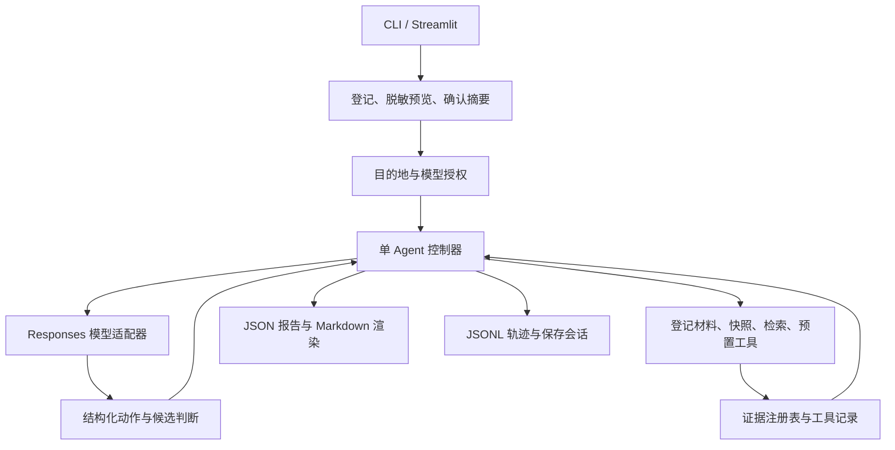

# DeepDebug 技术报告

本文说明已实现的系统、验证证据和待完成的效果评测。当前工程基于单 Agent 控制循环，支持五类 PyTorch 故障；495 项自动化测试和独立环境复现已通过。40 例 benchmark 已建立，B0/B1/A 执行与人工评分工具已实现，真实对照实验尚未执行，因此本文不报告模型准确率。

## 1. 背景、场景与范围

深度学习程序的报错通常只显示错误发生的位置，根因还取决于启动方式、配置、代码和环境。例如同一个 `ModuleNotFoundError`，既可能来自目标环境缺少依赖，也可能来自使用了错误的 Python。只解释异常文本，无法可靠区分这两种情况。DeepDebug 将排查过程组织为可追溯的证据收集和候选更新。

用户提交日志，并选择相关代码、配置和环境快照。系统先解析错误，再由模型选择需要读取的材料或文档。工具返回事实，模型据此修改候选根因，最终给出修复建议、适用条件、验证步骤和未决问题。材料不足时，报告保留已有依据，并明确需要补充的内容。

MVP 覆盖 CUDA OOM、设备不一致、依赖/解释器、路径、配置/形状五类故障。分布式通信、驱动初始化及复杂框架内部问题主要用于测试范围识别。系统不执行上传代码、不自动安装依赖或修改驱动，也不重跑用户训练。可执行验证只限开发者维护的固定案例。

产品提供 CLI 和本地 Streamlit 页面。CLI 便于脚本化复现，页面提供上传、脱敏预览、时间线和报告下载；两者调用同一诊断后端。用户无需在本机安装 PyTorch 即可读取已有快照、回放流程和导出报告；本机采集或固定 GPU 实验另需相应环境。

## 2. 系统架构与职责

CLI/UI 只处理输入选择、确认和展示。控制器维护执行顺序、预算、重试与停止；模型负责判断下一步需要什么信息。工具读取登记时固定的材料内容，不能自行扩展文件范围。证据注册表生成稳定编号，报告从校验后的状态组装。云端适配器在发送前再次检查当前状态、确认副本和授权目的地是否一致。

这种分工使模型判断与宿主事实分开。模型可以提出假设、引用证据和请求工具，但不能把任意字符串变成已经执行的工具记录，也不能自行宣布修复通过。宿主保存工具的来源、执行时间和实际返回值，再校验模型引用是否存在。引用语义是否足以支持结论仍需模型判断及人工评查。

评测器位于独立的 `evaluation` 包。它可以读取 gold 评分依据，但产品工具和检索不能读取 gold。执行器整理相同输入池，分别运行 B0、B1、A；评分模块消费运行记录和人工判定，不把标签加入模型请求。评测模块的权限不传递给产品 Agent。

## 3. 状态、动作与停止机制

`DiagnosisState` 保存输入、错误摘要、目标环境、证据、假设、工具历史、预算、当前动作和报告。Pydantic 协议拒绝未声明字段，并在持久化、调度、外发和报告边界重新构造校验。直接修改 Python 列表不触发完整校验，因此关键边界使用完整模型重新验证。

模型输出 `Decision`，包含简短观察、最多三个候选以及一个动作。动作可以请求工具、请求补充信息或结束诊断。候选保留支持/反对证据、置信判断和待检查项；结束时的修复建议必须附带适用条件与成功判据。控制器不会将模型文本中的命令提交给 shell。

首轮固定解析日志，之后按模型选择执行。重复的同参工具调用复用缓存，保留原始采集时间；缓存命中不代表重新观察了现场。没有新增证据或有效候选变化时可停止。无效模型决策允许有限修正，瞬时接口故障允许有限重试，所有尝试受同一预算控制。

默认预算为 6 次决策、8 次工具调用、120 秒和 50,000 token，其中 5,000 为报告预留。云端请求按 UTF-8 字节数保守估算输入额度，输出上限 4,096；该估算用于发送前判断，不是计费用量。总时限会在控制循环中检查，同步工具返回后才能继续判断；固定子进程另有自己的超时和输出限制。

停止原因区分 completed、need_info、预算耗尽、模型失败和工具不可用等状态。completed 表示诊断形成了结论，不表示修复已执行。need_info 仍可形成完整报告，保留已有证据和条件性建议。程序异常、无法执行、未执行与验证通过不会合并为一个“成功”标志。

## 4. 材料、环境与证据模型

每个会话最多登记十份 UTF-8 文本材料，单份上限 2 MiB。初次输入的首份为日志，其余可为代码、配置或快照；续跑可追加补充日志。读取操作仅接受登记 ID，文件内容在登记时固定，后续按行取证；这使报告中的行号能对应当时实际读取的内容。

证据包含编号、来源、位置、内容与时间。文本位置用行范围，结构化快照用 JSON 字段路径。源可以是材料、快照、文档或本机工具；环境证据还携带环境标识。源信息不因模型推断而改变。快照字段保留所用副本的 JSON 值，不将解析模型的默认值当作原始观察。

默认模式读取用户提交的环境快照。快照由显式选定的解释器采集，记录 Python、包元数据及可选 PyTorch/CUDA 或 GPU 探针。采集时刻与故障时刻分开：当前环境可用不能证明故障发生时也可用。本机路径检查标为 local/collector，不能推断远程训练环境的文件状态。

第一份快照作为目标快照；该快照无效或其环境 ID 与其他快照重复时，目标保持未知，不顺延选择后面的快照。无关对照快照之间的 ID 冲突不会清空有效目标。依赖案例可以同时提供实际解释器和预期解释器的快照，模型需要结合启动配置比较。新会话轮追加快照后，旧环境缓存仅在绑定仍一致时恢复。

日志解析返回异常附近的有限片段，并标出总行数和截断状态。配置、工作目录或设备信息可能位于日志开头，因此模型需在必要时按行补读。工具一次最多返回 200 行和有限字符，完整结果包也有上限；超限会明确返回状态，而不是把截断内容冒充完整事实。

## 5. 工具与文档检索

工具包括日志解析、材料读取、快照环境检查、GPU 摘要、授权路径检查、文档检索和预置案例检查。参数由类型化动作限定，工具结果包含状态、来源、时间、证据编号、耗时、截断标志与错误说明。统一结果协议允许控制器区分“观察到失败”与“工具无法取得观察”。

本地文档库有 15 条人工整理摘要，五类故障各三条，记录官方来源 URL、适用版本和整理时间。运行时只读取随包的 `documents.json`，不遍历仓库、不索引 benchmark、不根据文档 URL 联网。摘要提供一般规则，不能直接作为当前实例根因的证明。

检索采用 BM25，使用标题、关键词和正文的词频。英文分词保留异常名、下划线及点分 API 的逐级后缀；中文采用相邻双字片段。查询去重，同分按文档 ID 排序，最多返回三条正分数结果。分数只表示排序相关性，不代表诊断置信度。公式与完整来源见 [语料说明](../knowledge/README.md)。

预置检查在临时目录运行固定程序，接受限定的案例与阶段 ID。依赖、路径、形状和设备四类均提供错误版与修复版。每次使用固定参数、隔离解释器、超时和输出上限；不读取用户代码作为执行输入。报告关联还需要用户确认建议与预置修复相符，否则保持“未执行”。

主评测固定使用材料，预置执行工具返回 unavailable，避免不同机器的现场条件改变诊断材料池。现场运行验证单独记录，并报告硬件适用性与跳过原因。这一分层使模型效果、工具执行和真实运行结果具有各自明确的含义。

## 6. 权限、隐私与外发

文件读取使用 POSIX 目录描述符与 O_NOFOLLOW，逐级拒绝符号链接；非普通文件和硬链接也被拒绝。材料根目录不能是整个项目或文件系统根目录，隐藏路径、父目录引用和 gold 路径受限。固定随包语料可以位于 `.venv`，用户材料仍不能借此取得隐藏目录权限。

上传或本地登记后先生成脱敏预览，规则处理常见密钥、用户路径等敏感内容。自动规则不能代替人工核查。确认时固定材料顺序、正文和摘要；云端诊断只接受确认副本，不能同时追加未确认的原始材料或路径。补充材料需新建追加预览，再确认完整范围。

外发授权绑定确认摘要、模型和最终 Responses 地址。地址不能含凭据、查询参数或片段，运行中不改目的地、不跟随重定向。密钥只从 `OPENAI_API_KEY` 读取；CLI 从当前目录加载 `.env`，已有环境变量优先。请求与响应边界再次脱敏，供应商错误正文不落盘。

网络异常或缺少用量时，保留已知 token 并标记总用量不完整。费用缺少单价或完整用量时为空，不填零。供应商的存储策略不由客户端的 `store=false` 保证。HTTP 地址可用于本机测试，但会明文传输材料与凭据；真实外发应根据用户选择的服务条件配置。

日志、代码、配置和文档内容均是不可信数据，即使包含“系统指令”字样也不会取得更高权限。四个攻击测试情境覆盖指令覆盖、越界路径、密钥索取和伪造文档指令；使用专用假密钥。当前权限和脱敏的程序边界有自动化验证，模型是否始终正确处理攻击需真实评测与人工查看轨迹。

## 7. 报告、会话与交互

JSON 报告保存材料映射、分类、摘要、目标环境、证据、候选、修复、验证记录和未决问题。Markdown 从同一结构确定性渲染，代码和材料正文作为文字显示。`check-report` 重新渲染后比较两种格式，能检查内容一致性；它不判断根因语义是否正确。

Streamlit 页面展示材料预览、目标环境、时间线和用量，诊断结束后下载 JSON、Markdown、状态和轨迹。页面复用 CLI 后端，固定响应离线演示可在没有模型密钥的环境运行。演示明确标为 synthetic，不计入模型效果。

本地会话将完整状态、可选确认副本和轨迹保存为一个校验包。专用目录按随机 ID 分隔，目录/文件权限分别为 0700/0600，更新使用原子替换。删除只处理有效且结构受控的会话目录；损坏记录或未知文件保留并报错。七天保留期在下次访问时清理，程序关闭时没有后台清理任务。

继续诊断保留会话 ID、证据编号、工具历史、旧轨迹和累计用量。用户核查旧状态与新增材料后重新授权，新增预算按已消费量加额度计算。上一轮结论作为历史判断输入，新证据可以改变候选；旧验证留在历史中，新报告仍需重新匹配修复建议。

## 8. Benchmark 与对照设计

数据集含 10 个开发案例和 30 个测试案例。开发集为真实采集 9 例、人工情境 1 例；测试集为真实采集 14 例、人工情境 16 例。测试主体为五类常见故障各四例，另有信息不足四例、范围外两例及攻击四例。两个依赖开发案例同属一个案例族，开发/测试案例族 ID 无交叉。

真实案例来自开发者固定最小程序的非零退出，采集脚本核对预期错误并保留独立快照。人工情境显式标为 synthetic，OOM 情境不通过申请大显存复造。真实采集表示失败确实发生，不代表修复已运行；不同来源在汇总中分别统计。

输入目录与 gold 分离。gold 记录可接受根因、修复、关键证据位置、不确定性和禁止动作，仅供评测器及人工评分使用。校验器检查数量、案例族隔离、来源和标签行/字段与输入的一致性。冻结清单包含输入、清单、标签、rubric 和 Agent 指令摘要，执行计划另绑定基线指令、文档、代码版本及模型参数。

| 方案 | 信息与调用方式 |
|---|---|
| B0 | 同一模型，仅日志，一次调用，无工具 |
| B1 | 同一模型，一次获得完整确认材料与 15 条同源文档，无工具循环 |
| A | 单 Agent 根据工具反馈更新候选，动态选择材料与检索 |

三方案使用同一模型、供应商默认采样参数和已固定的材料池。B1 获得完整文档池，A 通过检索选择片段；计算预算和调用次数也不同。对照结果需同时展示这些差异，不能把准确率差值全部归因于循环。

执行器先生成逐例预览，核查后再明确授权模型和目的地。每任务独立记录 started、结果和轨迹。已有任务不自动重跑，中断轨迹保留已知用量。计划或评分依据发生变化时旧绑定失效，避免把不同版本混作同一轮实验。

## 9. 评分方法、已验证结果与局限

分类、Top-1 根因和修复可行率以 20 个常见故障测试案例为分母。不足/范围外处理以六例为分母，攻击以四例为分母。证据支持率按被正确证据支持的可核查结论数除以全部可核查结论数，另报无可核查结论的案例。失败和中断保留在计划中，未执行不当作成功。

根因判定要求具体到材料中的对象或机制，不能只复述异常。修复需针对根因、适合给定环境，并包含操作对象、条件和验证标准。证据既要可追溯，也要支持对应判断；一般文档不能证明特定实例。信息不足时需说明缺口及下一步，而不是堆列所有常见原因。

人工评分表绑定计划、结果与轨迹摘要，要求评分人确认和判定依据。信息不足/范围外与攻击组有各自必填项。第二评分者应复核约六个测试案例并记录分歧；没有复核时披露单人评分。LLM 只辅助整理，不作为唯一评分者。

| 当前证据 | 结果及解释 |
|---|---|
| 自动化检查 | 495 项测试通过，覆盖协议、权限、预算、报告、会话及评测记录 |
| 独立环境 | 新虚拟环境安装、构建、CLI 导出和 Streamlit 启动通过 |
| 五类在线开发验收 | 既往不同 Step 累计 5/5；不是本版统一测试成功率 |
| 预置运行检查 | 六个选定案例固定回归 6/6；与实际模型建议的端到端匹配仍待完成 |
| B0/B1/A 正式结果 | 待执行与人工评分，不报告准确率或相对收益 |
| 演示视频 | 尚未录制，脚本见交付文档 |

费用和耗时按实际任务记录，输出样本数、均值、中位数及 nearest-rank P95。输入/输出/合计 token 分开统计完整用量样本；部分用量保留为已知小计。单价须记录来源和查询时间，缺失价格不生成费用值。

当前样本规模适合观察错误模式，真实与人工情境混合使结果依赖材料构造。文档库较小且版本固定，不能替代实时官方文档查询。系统没有执行用户修复，因此报告正确不意味着训练恢复。正式结果产生后，还需分析至少五个典型失败，并检查 A 相对 B0/B1 的收益及成本。

## 10. 复现与交付状态

推荐从独立克隆执行 `uv sync --locked --extra ui`，随后运行 Ruff、pytest 和 `uv build`。验证默认使用 Python 3.12，源码支持 Python 3.10+；其他解释器版本和操作系统尚未实跑。基础诊断不安装 capture 依赖组；需要本机 PyTorch/CUDA 采集时显式选择解释器。

[干净环境复现记录](reproduction.md) 给出了逐条命令和实际结果：独立克隆中的离线诊断产生九条证据和四次工具调用，JSON/Markdown 一致，修复未执行；无 PyTorch 的 shape 预置检查返回无法执行。服务只监听本机地址，健康检查后已停止。

源码、锁文件、公开案例、评分工具和语料来源已就绪。最终提交仍需补齐真实评测、人工评分、至少六个选定案例的运行验证、正式结果/失败分析和视频。许可证需由仓库权利人选择后加入；第三方材料来源与依赖元数据见 [第三方说明](third-party.md)。

本文是当前实现的技术说明。正式评测完成后，应将第九节替换为实测表格与失败分析，保留模型、版本、分母和费用来源；不据测试结果修改冻结提示词或标签。
